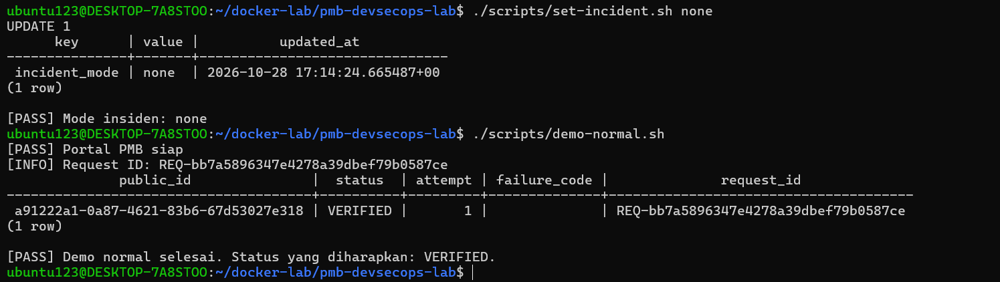
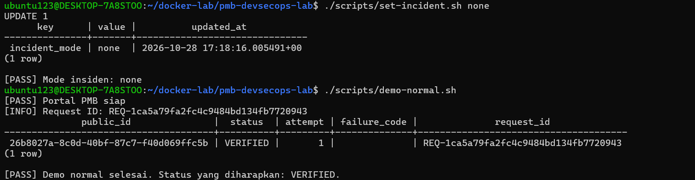

## 1. Tujuan Praktikum

Setelah melaksanakan praktikum ini, mahasiswa diharapkan mampu:

1. Menjelaskan kebutuhan centralized logging pada lingkungan container yang ephemeral.
2. Mengirim log stdout/stderr container aplikasi Portal PMB ke Fluent Bit menggunakan Docker fluentd logging driver.
3. Menyimpan log ke PostgreSQL (log-db) dalam kolom JSONB.
4. Membuat alur transaksi pendaftaran PMB (login, registrasi, verifikasi) sebagai sumber event log yang realistis.
5. Mengorelasikan event lintas service (`auth-service`, `registration-api`, dan `verification-worker`) menggunakan request ID.
6. Melakukan query analisis log, skenario failure injection, serta pengujian resilience logging pada Fluent Bit.

## 2. Alat dan Bahan

- Docker Engine dan Docker Compose v2
- Terminal/Command Line Interface (CLI)
- Text Editor (Nano, VS Code, atau sejenisnya)
- Bash, `curl`, dan Python 3 untuk validasi lokal

## 3. Landasan Teori

### 3.1 Centralized Logging

Pada lingkungan containerized, log yang hanya tersimpan di dalam container akan hilang saat container dihapus. Centralized logging mengumpulkan seluruh log dari berbagai service ke satu lokasi terpusat agar dapat dicari, dikorelasikan, diaudit, dan ditelusuri lintas service.

Pada praktikum ini, aplikasi yang dipakai adalah Portal PMB (Penerimaan Mahasiswa Baru) yang sebenarnya, bukan sekadar generator log. Ketiga layanan aplikasi (`auth-service`, `registration-api`, dan `verification-worker`) menulis event operasional dan bisnis ke `stdout`, kemudian Docker Engine meneruskannya ke Fluent Bit melalui logging driver `fluentd`.

### 3.2 Fluent Bit

Fluent Bit merupakan log processor dan forwarder yang ringan dan efisien. Fluent Bit menggunakan pipeline yang terdiri atas Input, Parser, Filter, Buffer, dan Output. Pada praktikum ini, Fluent Bit menerima log dari Docker fluentd logging driver melalui protokol Forward pada port `127.0.0.1:24224`, kemudian mengirimkannya ke PostgreSQL pada log-db. Tersedia pula output `stdout` untuk verifikasi dan endpoint HTTP Server pada port `127.0.0.1:2020` untuk monitoring.

### 3.3 Docker fluentd Logging Driver

Docker menyediakan logging driver fluentd yang mengarahkan log stdout/stderr dari container langsung ke Fluent Bit tanpa memodifikasi kode aplikasi. Penggunaan opsi `fluentd-async: "true"` bertujuan mengurangi blocking pada aplikasi apabila koneksi ke collector sempat tertunda, serta `fluentd-buffer-limit` menetapkan batas buffer yang digunakan pada pengujian resilience logging.

Tag yang dihasilkan Docker logging driver adalah `pmb.{{.Name}}`, misalnya `pmb.pmb-lab-registration-api-1`, sehingga setiap layanan aplikasi dapat dipisahkan pada tabel `logs.fluentbit`.

### 3.4 PostgreSQL dan JSONB

Log disimpan pada schema `logs` dengan tabel `logs.fluentbit` yang memiliki kolom `tag`, `time`, dan `data` bertipe JSONB. Penggunaan JSONB memungkinkan penyimpanan log semi-terstruktur serta query berbasis field. Indeks pada `time`, `tag`, dan GIN pada `data` digunakan untuk mempercepat pencarian. Tersedia pula view `logs.recent_logs` untuk menampilkan log terbaru.

Selain itu, pada praktikum ini terdapat database transaksi `pmbdb` yang menyimpan tabel `registrations` beserta kontrol insiden pada tabel `lab_control`. Status transaksi (`SUBMITTED`, `PROCESSING`, `VERIFIED`, `FAILED`) dan failure code (`VERIFY-TIMEOUT`) menjadi konteks penting untuk mengaitkan kegagalan dengan sequence event pada log.

## 4. Langkah Kerja Praktikum

### Langkah A. Persiapan Direktori

```bash
mkdir -p ~/docker-lab/pmb-devsecops-lab/{app,fluent-bit,init-app,init-log,queries,reports,scripts}
cd ~/docker-lab/pmb-devsecops-lab
```

Struktur direktori laboratorium PMB:

```text
pmb-devsecops-lab/
├── .env.example
├── compose.yaml
├── app/
├── fluent-bit/
├── init-app/
├── init-log/
├── queries/
├── reports/
└── scripts/
```

### Langkah B. Konfigurasi Lingkungan (.env)

File `.env.example` yang disediakan:

```env
COMPOSE_PROJECT_NAME=pmb-lab

APP_DB_NAME=pmbdb
APP_DB_ADMIN_USER=pmb_admin
APP_DB_ADMIN_PASSWORD=change-me-app-admin
APP_DB_USER=pmb_app
APP_DB_PASSWORD=change-me-app-writer

LOG_DB_NAME=logdb
LOG_DB_ADMIN_USER=log_admin
LOG_DB_ADMIN_PASSWORD=change-me-log-admin
FLUENTBIT_DB_USER=fluentbit_writer
FLUENTBIT_DB_PASSWORD=change-me-log-writer

SESSION_SECRET=change-me-session-secret
LAB_USERNAME=student
LAB_USER_REF=USR-LAB-001
LAB_PASSWORD_SALT=pmb-lab-static-salt-v1
LAB_PASSWORD_HASH=43300d37616f9029aa73fd2fd401d13ae60db49a56dbd42cedafcc1f5675923a

AUTH_URL=http://auth-service:8081
WORKER_POLL_SECONDS=2
FLASK_ENV=production
```


Salin dan atur permission:

```bash
cp .env.example .env
chmod 600 .env
```


### Langkah C. File compose.yaml

File `compose.yaml` yang disediakan pada folder tugas `pmb-devsecops-lab` memuat service `app-db`, `log-db`, `fluent-bit`, `auth-service`, `registration-api`, dan `verification-worker`, termasuk konfigurasi network `app-net`, `logging-net`, serta volume `app-db-data`, `log-db-data`, dan `fluent-bit-buffer`. Ketiga layanan aplikasi (`auth-service`, `registration-api`, dan `verification-worker`) menggunakan logging driver `fluentd` dengan `fluentd-async: "true"` dan tag `pmb.{{.Name}}`.

```yaml
x-fluentd-logging: &fluentd-logging
  driver: fluentd
  options:
    fluentd-address: "127.0.0.1:24224"
    fluentd-async: "true"
    fluentd-buffer-limit: "4096"
    tag: "pmb.{{.Name}}"
```


### Langkah D. Inisialisasi Database

File `init-log/01-init-log.sh` yang disediakan untuk:

1. Membuat role/user `fluentbit_writer` berdasarkan variabel lingkungan.
2. Membuat schema `logs`.
3. Membuat tabel `logs.fluentbit` (id, tag, time, data JSONB).
4. Membuat indeks `idx_fb_time`, `idx_fb_tag`, `idx_fb_data_gin`.
5. Membuat view `logs.recent_logs`.
6. Memberikan privilege INSERT/SELECT ke `fluentbit_writer`.

File `init-app/01-init-app.sh` yang disediakan untuk:

1. Membuat role/user `pmb_app` pada database transaksi `pmbdb`.
2. Membuat tabel `registrations` (public_id, user_ref, full_name, email, program, status, attempt, failure_code, request_id, timestamps).
3. Membuat tabel `lab_control` untuk mode insiden (`none` atau `timeout`).

### Langkah E. Konfigurasi Fluent Bit (fluent-bit/fluent-bit.conf)

File `fluent-bit/fluent-bit.conf` yang disediakan dengan pengaturan:

- [SERVICE]: flush interval, log_level, HTTP Server pada `0.0.0.0:2020`
- [INPUT]: forward pada `0.0.0.0:24224`
- [OUTPUT]: pgsql ke `log-db:5432` dengan database `logdb`, schema `logs`, table `fluentbit`, user/password dari lingkungan
- [OUTPUT]: stdout untuk verifikasi (opsional)

```ini
[SERVICE]
    Flush                     1
    Daemon                    Off
    Log_Level                 info
    storage.path              /var/log/flb-storage
    storage.sync              normal
    storage.checksum          on
    storage.backlog.mem_limit 10M
    HTTP_Server               On
    HTTP_Listen               0.0.0.0
    HTTP_Port                 2020

[INPUT]
    Name          forward
    Listen        0.0.0.0
    Port          24224
    Mem_Buf_Limit 10M
    storage.type  filesystem

[OUTPUT]
    Name                     pgsql
    Match                    pmb.*
    Host                     log-db
    Port                     5432
    User                     ${FLUENTBIT_DB_USER}
    Password                 ${FLUENTBIT_DB_PASSWORD}
    Database                 ${LOG_DB_NAME}
    Table                    fluentbit
    storage.total_limit_size 256M

[OUTPUT]
    Name   stdout
    Match  pmb.*
    Format json_lines
```


### Langkah F. Menjalankan Stack

```bash
./scripts/setup.sh
./scripts/validate.sh
docker compose up -d --build
docker compose ps
```


### Langkah G. Verifikasi Awal

Lihat status container:

```bash
docker compose ps
```


Periksa kesehatan endpoint:

```bash
curl -fsS http://127.0.0.1:2020/api/v1/health
curl -fsS http://127.0.0.1:8080/healthz
curl -fsS http://127.0.0.1:8081/healthz
```


Masuk ke database log dan query verifikasi:

```bash
docker compose exec -T log-db \
    psql --username "$LOG_DB_ADMIN_USER" --dbname "$LOG_DB_NAME" --file /dev/stdin < queries/incident-analysis.sql
```


Distribusi log per service:

```bash
docker compose exec -T log-db \
    psql --username "$LOG_DB_ADMIN_USER" --dbname "$LOG_DB_NAME" \
    --command "SELECT tag, COUNT(*) AS total_event FROM logs.fluentbit GROUP BY tag ORDER BY total_event DESC, tag;"
```


### Langkah H. Skenario Logging — Tahap A Sampai Tahap D

Laboratorium menyediakan skenario logging yang berurutan melalui direktori `scripts/` pada `pmb-devsecops-lab`.

#### Tahap A — Baseline (mode `none`)

Jalankan mode normal, kirim pendaftaran normal, dan catat request ID serta rentang waktu.

```bash
./scripts/set-incident.sh none
./scripts/demo-normal.sh
```



Alur yang diharapkan:

```text
login_success
  → registration_submitted
  → verification_started
  → verification_completed
  → status VERIFIED
```

#### Tahap B — Failure Injection (mode `timeout`)

Aktifkan mode `timeout`, kirim pendaftaran baru, lalu amati tiga percobaan verifikasi dan kegagalan.

```bash
./scripts/set-incident.sh timeout
./scripts/demo-incident.sh
```


#### Tahap C — Recovery (kembalikan mode `none`)

```bash
./scripts/set-incident.sh none
./scripts/demo-normal.sh
```



Transaksi baru harus berakhir `VERIFIED`. Transaksi lama yang `FAILED` tidak otomatis berubah status.

#### Tahap D — Resilience Logging

Hentikan `log-db` sementara, hasilkan transaksi baru, amati retry dan penggunaan buffer Fluent Bit, lalu jalankan kembali `log-db`.

```bash
docker compose stop log-db
./scripts/demo-normal.sh
docker compose start log-db
```


Atau pakai skenario logging yang sudah terintegrasi untuk verifikasi pipeline aplikasi → Fluent Bit → log-db:

```bash
./scripts/scenario-logging.sh
```


### Catatan Troubleshooting — Network pada Lab PMB

Pada praktikum ini, `pmb-devsecops-lab` dalam folder tugas **tidak dibuat dari awal** melalui setup manual, melainkan sudah disediakan sebagai folder tugas yang harus dianalisis dan dijalankan. Ketika proses pemeriksaan kesehatan endpoint setelah menjalankan stack belum sempat dilakukan, ditemukan masalah pada konfigurasi `networks`. Sebelumnya nilai konfigurasinya masih **`internal: true`**; setelah dilakukan perbaikan dengan mengubahnya menjadi **`driver: bridge`**, mapping port publik (`127.0.0.1`) pada host akhirnya muncul dan hasil pemeriksaan melalui `curl` berhasil ditampilkan.

```yaml
networks:
  app-net:
    driver: bridge
  logging-net:
    driver: bridge
```

```bash
docker compose up -d --force-recreate
docker compose ps
curl -fsS http://127.0.0.1:2020/api/v1/health
curl -fsS http://127.0.0.1:8080/healthz
curl -fsS http://127.0.0.1:8081/healthz
```


Contoh hasil pemeriksaan kesehatan endpoint setelah perbaikan network:

```text
{"fluent-bit":{"version":"4.2.8","edition":"Community",...}}
{"service":"registration-api","status":"ok"}
```

Dengan perbaikan ini, network tidak lagi berstatus internal sehingga traffic host ke container serta komunikasi antar container dapat berjalan normal, mapping port publik (`127.0.0.1`) muncul, dan health endpoint pada port `2020` serta portal pada port `8080`/`8081` dapat diverifikasi.

## 5. Verifikasi Hasil

Setelah skenario logging dijalankan, periksa hal-hal berikut:

- [x] Semua container dalam keadaan Up/Healthy
- [x] Fluent Bit menerima log dari tiga layanan aplikasi PMB
- [x] Data masuk ke tabel `logs.fluentbit`
- [x] View `logs.recent_logs` berfungsi dengan baik
- [x] Distribusi log per service dapat ditampilkan
- [x] Monitoring Fluent Bit dapat diakses di `http://127.0.0.1:2020`
- [x] Skenario normal menghasilkan status `VERIFIED`
- [x] Skenario timeout menghasilkan `VERIFY-TIMEOUT` dengan tiga retry
- [x] Log sensitif tidak tersimpan pada database log


## 6. Analisis Hasil

Berdasarkan pelaksanaan praktikum, diperoleh beberapa analisis:

1. Docker fluentd logging driver berhasil mengalihkan log stdout/stderr layanan aplikasi PMB ke Fluent Bit tanpa perlu mengubah kode aplikasi.
2. Fluent Bit berfungsi sebagai collector terpusat dengan pipeline yang menargetkan tag `pmb.*`.
3. Aplikasi PMB menulis event structured JSON pada `stdout`, sehingga data cukup kuat untuk dianalisis lintas service melalui `request_id`.
4. Kegagalan verifikasi pada mode `timeout` terdeteksi melalui event `verification_retry` dan `dependency_timeout` sekaligus status transaksi `FAILED` — hal ini membuktikan nilai centralized logging.
5. Mekanisme buffering pada Fluent Bit berperan penting apabila backend log (`log-db`) terganggu sementara.

Karakteristik penyimpanan pada tabel `logs.fluentbit` dapat dilihat dari beberapa bukti berikut:

```text
              tag                | total_event 
-----------------------------------+-------------
 pmb.pmb-lab-registration-api-1    |         888
 pmb.pmb-lab-auth-service-1        |         435
 pmb.pmb-lab-verification-worker-1 |         15
 (3 rows)
```

## 7. Evaluasi dan Latihan Mandiri

1. **Apa risiko kehilangan log ketika Fluent Bit tidak tersedia?**
   Log bisa hilang bila tidak ada buffering. Dengan Docker fluentd driver dan `fluentd-async`, log dapat tertunda/terbuang saat koneksi collector down; buffer filesystem pada Fluent Bit menunda pengiriman ke PostgreSQL.

2. **Mengapa structured logging lebih mudah dianalisis dibanding plain text logging?**
   Struktur (JSON) bisa di-query per field, difilter, dan diagregasi. Plain text harus di-parse/manual.

3. **Kapan PostgreSQL tidak lagi cocok sebagai log storage utama?**
   Saat ingest sangat tinggi, volume besar, retensi panjang, atau pencarian skala besar; untuk skala produksi lebih cocok Loki/ClickHouse/OpenSearch.

4. **Apa perbedaan log untuk observability dan log untuk forensik?**
   Observability: real-time, agregasi, deteksi anomali. Forensik: jejak lengkap, immutable, timestamp akurat, audit trail.

5. **Buat query SQL untuk menampilkan jumlah log per menit dalam 10 menit terakhir.**

   ```sql
   SELECT date_trunc('minute', time) AS menit, COUNT(*) AS jumlah
   FROM logs.fluentbit
   WHERE time >= NOW() - INTERVAL '10 minutes'
   GROUP BY menit
   ORDER BY menit ASC;
   ```

## 8. Kesimpulan

Berdasarkan praktikum ini, berhasil diimplementasikan centralized logging pada Portal PMB menggunakan Docker fluentd logging driver, Fluent Bit, dan PostgreSQL. Log aplikasi PMB berhasil dikumpulkan secara terpusat, disimpan terstruktur dalam JSONB, dan dianalisis melalui query SQL serta skenario failure injection. Request ID, redaction, dan mekanisme buffering menjadi bagian penting dalam membuktikan keamanan dan reliabilitas log.

## 9. Daftar Pustaka

1. Fluent Bit Documentation - PostgreSQL Output Plugin. https://docs.fluentbit.io/manual/data-pipeline/outputs/postgresql
2. Fluent Bit Documentation - Buffering & Storage. https://docs.fluentbit.io/manual/data-pipeline/buffering
3. Fluent Bit Documentation - Monitoring. https://docs.fluentbit.io/manual/administration/monitoring
4. Docker Documentation - Fluentd logging driver. https://docs.docker.com/engine/logging/drivers/fluentd/
5. Docker Documentation - Configure logging drivers. https://docs.docker.com/engine/logging/configure/
6. PostgreSQL Documentation - JSON Types. https://www.postgresql.org/docs/current/datatype-json.html
7. Flask Documentation. https://flask.palletsprojects.com/
8. Gunicorn Documentation. https://docs.gunicorn.org/
9. Psycopg Documentation. https://www.psycopg.org/psycopg3/
10. Requests Documentation. https://requests.readthedocs.io/
