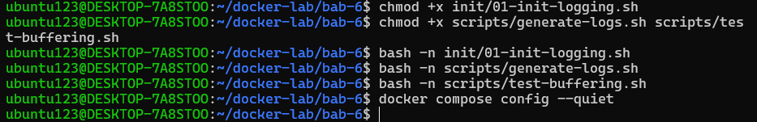
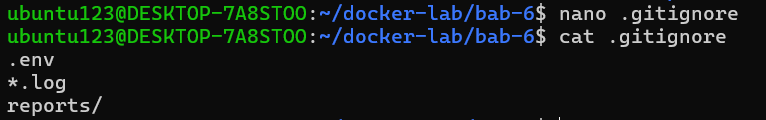
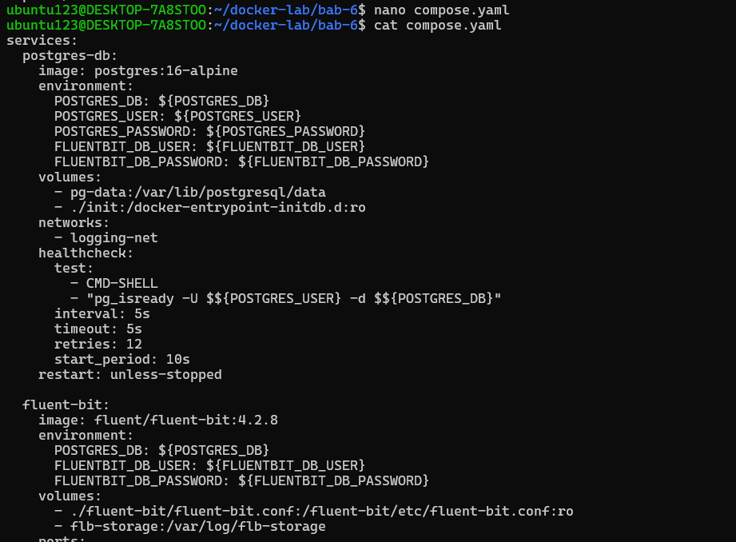
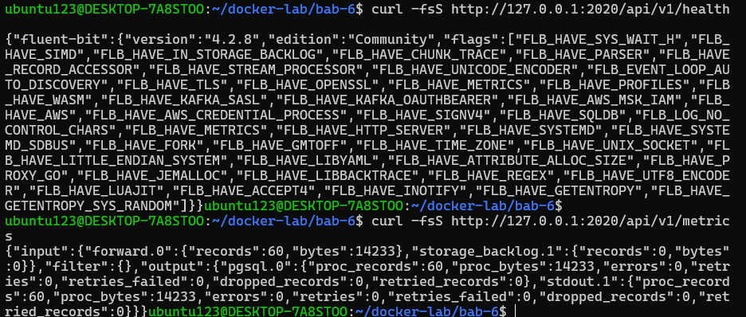

# PRAKTIKUM BAB 6
## Centralized Logging dengan Fluent Bit dan PostgreSQL

| Keterangan | Isi |
| --- | --- |
| Mata Kuliah | DevSecOps |
| Nama | Arsyita Devanaya Arianto |
| NIM | 3126640046 |
| Kelas | D4 RPL IT B |

## DAFTAR ISI

- [1. Tujuan Praktikum](#1-tujuan-praktikum)
- [2. Alat dan Bahan](#2-alat-dan-bahan)
- [3. Landasan Teori](#3-landasan-teori)
- [4. Langkah Kerja Praktikum](#4-langkah-kerja-praktikum)
- [5. Verifikasi Hasil](#5-verifikasi-hasil)
- [6. Analisis Hasil](#6-analisis-hasil)
- [7. Latihan Mandiri dan Jawaban](#7-latihan-mandiri-dan-jawaban)
- [8. Tabel Verifikasi PASS/FAIL](#8-tabel-verifikasi-PASS/FAIL)
- [9. Evaluasi dan Latihan Mandiri](#9-evaluasi-dan-latihan-mandiri)
- [10. Kesimpulan](#10-kesimpulan)
- [11. Daftar Pustaka](#11-daftar-pustaka)

## 1. Tujuan Praktikum

Setelah melaksanakan praktikum ini, mahasiswa diharapkan mampu:

1. Menjelaskan kebutuhan centralized logging pada lingkungan container yang ephemeral.
2. Mengirim log stdout/stderr container ke Fluent Bit menggunakan Docker fluentd logging driver.
3. Menyimpan log ke PostgreSQL dalam kolom JSONB.
4. Membuat log generator untuk simulasi event log.
5. Melakukan query analisis log dan memahami mekanisme buffering pada Fluent Bit.

## 2. Alat dan Bahan

- Docker Engine dan Docker Compose v2
- Terminal/Command Line Interface (CLI)
- Text Editor (Nano, VS Code, atau sejenisnya)

## 3. Landasan Teori

### 3.1 Centralized Logging

Pada lingkungan containerized, log yang hanya tersimpan di dalam container akan hilang saat container dihapus. Centralized logging mengumpulkan seluruh log dari berbagai service ke satu lokasi terpusat agar dapat dicari, dikorelasikan, diaudit, dan ditelusuri lintas service.

### 3.2 Fluent Bit

Fluent Bit merupakan log processor dan forwarder yang ringan dan efisien. Fluent Bit menggunakan pipeline yang terdiri atas Input, Parser, Filter, Buffer, dan Output. Pada praktikum ini, Fluent Bit menerima log dari Docker fluentd logging driver melalui protokol Forward pada port 24224, kemudian mengirimkannya ke PostgreSQL.

### 3.3 Docker fluentd Logging Driver

Docker menyediakan logging driver fluentd yang mengarahkan log stdout/stderr dari container langsung ke Fluent Bit tanpa memodifikasi kode aplikasi. Penggunaan opsi `fluentd-async: "true"` bertujuan mengurangi blocking pada aplikasi apabila koneksi ke collector sempat tertunda.

### 3.4 PostgreSQL dan JSONB

Log disimpan pada schema `logs` dengan tabel `fluentbit` yang memiliki kolom `tag`, `time`, dan `data` bertipe JSONB. Penggunaan JSONB memungkinkan penyimpanan log semi-terstruktur serta query berbasis field. Indeks pada `time`, `tag`, dan GIN pada `data` digunakan untuk mempercepat pencarian. Tersedia pula view `logs.recent_logs` untuk menampilkan log terbaru.

## 4. Langkah Kerja Praktikum

### Langkah A. Persiapan Direktori

```bash
mkdir -p ~/docker-lab/bab-6/{init,fluent-bit,queries,scripts}
cd ~/docker-lab/bab-6
```


### Langkah B. Konfigurasi Lingkungan (.env, .gitignore)

Buat file `.env.example`:

```env
POSTGRES_DB=labdb
POSTGRES_USER=labadmin
POSTGRES_PASSWORD=labadminpass123
FLUENTBIT_DB_USER=fluentbit_user
FLUENTBIT_DB_PASSWORD=fluentbitpass123
```


Salin dan atur permission:

```bash
cp .env.example .env
chmod 600 .env
```


```bash
chmod 600 .env
```



Buat `.gitignore`:

```gitignore
.env
*.log
reports/
```




### Langkah C. Membuat compose.yaml

Buat file `compose.yaml` dengan service `postgres-db`, `fluent-bit`, `generator-auth`, `generator-api`, `generator-worker`. Konfigurasikan network `logging-net`, volume `pg-data` dan `flb-storage`, serta gunakan `logging.driver: fluentd` pada ketiga generator dengan `fluentd-address: "127.0.0.1:24224"`, `fluentd-async: "true"`, dan tag `docker.{{.Name}}`.


### Langkah D. Inisialisasi Database (init/01-init-logging.sh)

Buat file `init/01-init-logging.sh` untuk:

1. Membuat role/user `fluentbit_user` berdasarkan variabel lingkungan.
2. Membuat schema `logs`.
3. Membuat tabel `logs.fluentbit` (id, tag, time, data JSONB).
4. Membuat indeks `idx_fb_time`, `idx_fb_tag`, `idx_fb_data_gin`.
5. Membuat view `logs.recent_logs`.
6. Memberikan privilege INSERT/SELECT ke `fluentbit_user`.


### Langkah E. Konfigurasi Fluent Bit (fluent-bit/fluent-bit.conf)

Buat file `fluent-bit/fluent-bit.conf` dengan pengaturan:

- [SERVICE]: flush interval, log_level, HTTP Server pada 0.0.0.0:2020
- [INPUT]: forward pada 0.0.0.0:24224
- [OUTPUT]: pgsql ke postgres-db:5432 dengan database labdb, schema logs, table fluentbit, user/password dari lingkungan
- [OUTPUT]: stdout untuk verifikasi (opsional)


### Langkah F. Menjalankan Stack

```bash
docker compose up -d
docker compose ps
```


### Langkah G. Verifikasi Awal

Lihat log Fluent Bit:

```bash
docker compose logs --tail=30 fluent-bit
```


Masuk ke PostgreSQL:

```bash
docker compose exec postgres-db psql -U labadmin -d labdb
```


Lakukan query verifikasi:

```sql
\dn
\dt logs.*
SELECT COUNT(*) FROM logs.fluentbit;
SELECT * FROM logs.recent_logs LIMIT 10;
SELECT tag, COUNT(*) AS total FROM logs.fluentbit GROUP BY tag ORDER BY total DESC;
```





## 5. Verifikasi Hasil

Setelah stack berjalan, periksa hal-hal berikut:

- [x] Semua container dalam keadaan Up/Healthy
- [x] Fluent Bit menerima log melalui input forward
- [x] Data masuk ke tabel logs.fluentbit
- [x] View logs.recent_logs berfungsi dengan baik
- [x] Distribusi log per tag dapat ditampilkan
- [x] Monitoring Fluent Bit dapat diakses di http://127.0.0.1:2020


## 6. Analisis Hasil

Berdasarkan pelaksanaan praktikum, diperoleh beberapa analisis:

1. Docker fluentd logging driver berhasil mengalihkan log stdout/stderr container ke Fluent Bit tanpa perlu mengubah kode aplikasi.
2. Fluent Bit berfungsi sebagai collector terpusat dengan pipeline yang rapi. Penggunaan fluentd-async membantu mengurangi risiko blocking pada aplikasi.
3. PostgreSQL dengan JSONB fleksibel untuk log semi-terstruktur. Indeks yang dibuat membantu mempercepat query analisis.
4. Mekanisme buffering pada Fluent Bit berperan penting apabila koneksi ke PostgreSQL terganggu sementara.
5. Untuk skala laboratorium, PostgreSQL cukup sesuai. Untuk volume log yang sangat besar, dibutuhkan solusi observability yang lebih skalabel seperti Loki, ClickHouse, atau OpenSearch.

## 7. Latihan Mandiri dan Jawaban

Berdasarkan cheatsheet Bab 6:

### 1) Tambahkan field request_id pada generator dan susun query untuk menelusuri satu transaksi lintas service

Jawaban:
- Tambahkan field request_id (UUID) pada output JSON generator.
- Karena log dikirim melalui fluentd driver ke Fluent Bit, request_id akan tersimpan di dalam data JSONB.
- Query untuk menelusuri:

```sql
SELECT id, time, tag, data->>'container_name' AS container, data->>'log' AS log
FROM logs.fluentbit
WHERE data->>'log' ILIKE '%<REQUEST_ID>%'
ORDER BY time ASC;
```

### 2) Modifikasi pipeline agar isi JSON pada data.log diparse menjadi field terstruktur. Tulis pengujian negatif untuk log yang bukan JSON valid

Jawaban:
- Tambahkan Parser JSON di fluent-bit.conf dan Filter dengan plugin parser untuk Key_Name log.
- Atur Reserve_Data On agar data asli tetap disimpan.
- Pengujian negatif: kirim baris plain text (bukan JSON). Parser akan gagal, namun Fluent Bit tidak crash. Kegagalan parse dapat dipantau melalui endpoint monitoring :2020.

### 3) Sisipkan nilai canary yang menyerupai token sintetis, lalu rancang filter redaction dan buktikan nilai tersebut tidak mencapai PostgreSQL

Jawaban:
- Sisipkan canary, contoh: CANARY_TOKEN_LAB6_SYNTHETIC_X9
- Tambahkan filter (lua/modify) untuk mengganti pola token dengan [REDACTED] sebelum output ke PostgreSQL
- Pembuktian:

```sql
SELECT COUNT(*) FROM logs.fluentbit WHERE data::text ILIKE '%CANARY_TOKEN%';
```

Jika filter aktif dan diterapkan pada log baru, hasilnya 0 untuk nilai canary asli.

### 4) Bandingkan jumlah event yang dihasilkan, diterima input Fluent Bit, dan tersimpan di PostgreSQL. Jelaskan setiap selisih

Jawaban:
- Dihasilkan: jumlah baris yang dicetak generator
- Diterima input Fluent Bit: dilihat dari metrics input di :2020
- Tersimpan di PostgreSQL: `SELECT COUNT(*) FROM logs.fluentbit;`
- Selisih dapat terjadi karena buffering/retry, koneksi terputus sesaat, parse error (record di-skip), backpressure, atau perbedaan waktu pengukuran.

### 5) Rancang kebijakan retensi tujuh hari yang dapat dijalankan terjadwal tanpa mengunci tabel secara berlebihan

Jawaban:
- Gunakan batch delete: hapus bertahap per 1000-5000 baris dengan `WHERE time < NOW() - INTERVAL '7 days'` menggunakan ctid/id, ulang hingga selesai. Jadwalkan dengan cron atau pg_cron.
- Alternatif lebih efisien: partitioning per hari, lalu DROP TABLE partisi yang lebih tua dari 7 hari (lock minimal).
- Pastikan ada indeks pada kolom time.

### 6) Jelaskan mengapa PostgreSQL sesuai untuk laboratorium ini, tetapi belum tentu tepat untuk telemetry berukuran sangat besar

Jawaban:
- Cocok untuk lab: mudah dipahami, SQL fleksibel, JSONB + indeks, integrasi langsung dengan Fluent Bit, baik untuk pembelajaran.
- Belum tepat untuk skala besar: ingest sangat tinggi membebani WAL, vacuum, indeks. Pencarian agregasi skala besar kurang efisien. Untuk high-throughput, solusi seperti Loki, ClickHouse, atau OpenSearch lebih sesuai.


## 8. Tabel Verifikasi PASS/FAIL

| No. | Skenario | Evidence yang sahih | PASS | FAIL |
|---:|---|---|---|---|
| 1 | Validasi Compose | `docker compose config --quiet` mengembalikan kode 0 | Konfigurasi valid | Galat YAML/interpolasi |
| 2 | Kesehatan backend | `docker compose ps` menampilkan PostgreSQL sehat | `healthy` | `unhealthy`/restart loop |
| 3 | Kesehatan collector | `/api/v1/health` merespons sukses | HTTP 2xx | Timeout/connection refused |
| 4 | Tiga sumber log | Query `GROUP BY tag` menampilkan tiga tag generator | ≥3 tag | <3 tag |
| 5 | Struktur record | Query menampilkan `container_name`, `source`, dan `log` | Field terisi | Field kosong/tidak ada |
| 6 | Penyimpanan JSONB | `pg_typeof(data)` bernilai `jsonb` | `jsonb` | Tipe lain/query gagal |
| 7 | Pemulihan output | `test-buffering.sh` menunjukkan jumlah bertambah | `[PASS]` | Tidak ada kenaikan |
| 8 | Pembatasan jaringan | PostgreSQL tidak memiliki published port | Hanya internal network | Port 5432 terbuka ke semua interface |

## 9. Evaluasi dan Latihan Mandiri

1. **Apa risiko kehilangan log ketika Fluent Bit tidak tersedia?**  
   Log bisa hilang jika tidak ada buffering. Dengan Docker fluentd driver dan `fluentd-async`, log bisa tertunda/terbuang saat koneksi collector down.

2. **Mengapa structured logging lebih mudah dianalisis dibanding plain text logging?**  
   Struktur (JSON) bisa di-query per field, difilter, dan diagregasi. Plain text harus di-parse/manual, lebih lambat & rawan salah.

3. **Kapan PostgreSQL tidak lagi cocok sebagai log storage utama?**  
   Saat ingest sangat tinggi (ribuan event/detik), volume besar, butuh pencarian full-text skala besar, atau retensi jangka panjang. Lebih cocok pakai Loki/ClickHouse/OpenSearch.

4. **Apa perbedaan log untuk observability dan log untuk forensik?**  
   - *Observability*: fokus real-time, agregasi, deteksi anomali.  
   - *Forensik*: butuh jejak lengkap, immutable, timestamp akurat, bisa dibuktikan (audit trail).

5. **Buat query SQL untuk menampilkan jumlah log per menit dalam 10 menit terakhir.**  

   ```sql
   SELECT date_trunc('minute', time) AS menit, COUNT(*) AS jumlah
   FROM logs.fluentbit
   WHERE time >= NOW() - INTERVAL '10 minutes'
   GROUP BY menit
   ORDER BY menit ASC;
   ```

## 10. Kesimpulan

Berdasarkan praktikum ini, berhasil diimplementasikan centralized logging menggunakan Docker fluentd logging driver, Fluent Bit, dan PostgreSQL. Log berhasil dikumpulkan secara terpusat, disimpan terstruktur dalam JSONB, dan dapat dianalisis melalui query SQL. Hal ini menunjukkan pemisahan yang tepat antara aplikasi dan log collector pada lingkungan container.

## 11. Daftar Pustaka

1. Fluent Bit Documentation - PostgreSQL Output Plugin. https://docs.fluentbit.io/manual/data-pipeline/outputs/postgresql
2. Fluent Bit Documentation - Buffering & Storage. https://docs.fluentbit.io/manual/data-pipeline/buffering
3. Fluent Bit Documentation - Monitoring. https://docs.fluentbit.io/manual/administration/monitoring
4. Docker Documentation - Fluentd logging driver. https://docs.docker.com/engine/logging/drivers/fluentd/
5. Docker Documentation - Configure logging drivers. https://docs.docker.com/engine/logging/configure/
6. PostgreSQL Documentation - JSON Types. https://www.postgresql.org/docs/current/datatype-json.html

1. Fluent Bit Documentation - PostgreSQL Output Plugin. https://docs.fluentbit.io/manual/data-pipeline/outputs/postgresql
2. Fluent Bit Documentation - Buffering & Storage. https://docs.fluentbit.io/manual/data-pipeline/buffering
3. Fluent Bit Documentation - Monitoring. https://docs.fluentbit.io/manual/administration/monitoring
4. Docker Documentation - Fluentd logging driver. https://docs.docker.com/engine/logging/drivers/fluentd/
5. Docker Documentation - Configure logging drivers. https://docs.docker.com/engine/logging/configure/
6. PostgreSQL Documentation - JSON Types. https://www.postgresql.org/docs/current/datatype-json.html
